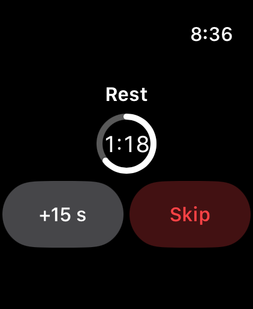
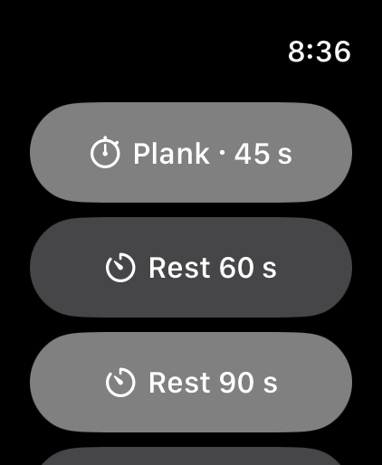

# Apple Watch

The TrainMe Apple Watch app puts your rest timer on your wrist, so you can coach without picking up your phone.

{: width="200"} {: width="200"}

## Install

TrainMe for Apple Watch installs with the iPhone app. If it's not on your watch, open the **Watch** app on your iPhone, find TrainMe and tap **Install**.

## While a timer is running

The watch shows the countdown ring. Tap **+15 s** to add time or `Skip` to end it. Your iPhone stays in sync, and your watch taps your wrist when the time is up.

## Start a timer from the watch

When nothing is running, the watch shows quick-start buttons:

- the **next timed set** in the session you have open on your iPhone (for example *Plank · 45 s*),
- `Rest` buttons for 60, 90 and 120 seconds — your default rest is highlighted.

## Good to know

- The watch gets its timer from your iPhone, so keep your iPhone nearby with Bluetooth on and TrainMe open in a session.
- No client information is sent to the watch — only the timer and the next exercise's name.
