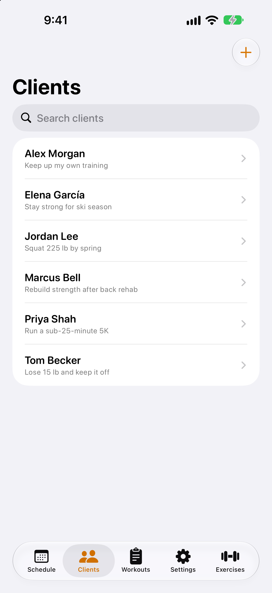
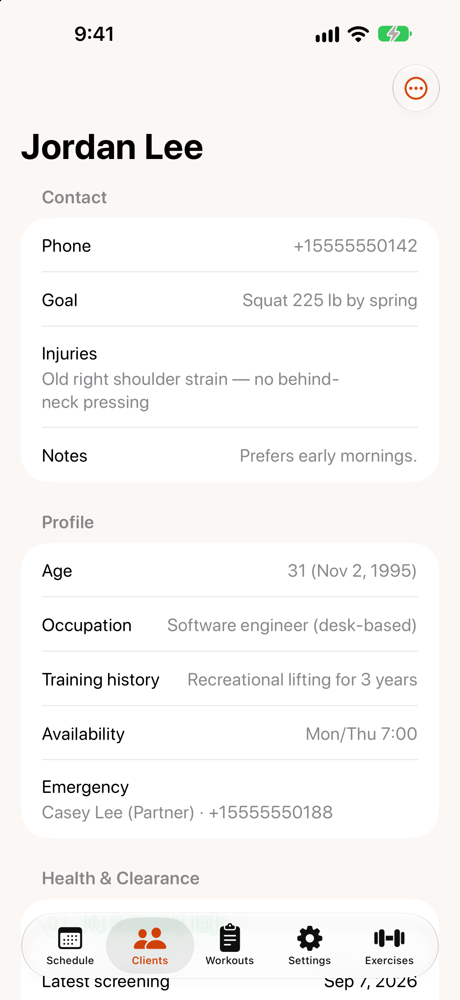

# Clients and intake

{: width="280"} {: width="280"}

## Add a client

1. Open the `Clients` tab and tap **+** (`Add`).
2. Fill in the client's name and mobile phone number. Everything else is optional:
   - **Training:** primary goal and any injuries or limitations.
   - **Profile:** date of birth, occupation, training history and availability.
   - **Emergency contact** and **Physician**: name, relationship and phone.
   - **Notes.**
3. Tap `Save`.

TrainMe then asks whether to start intake for the new client. Tap `Start intake` to do it now, or `Later` to do it from the client's page another time.

### Track your own training

Tap `Add yourself` on an empty Clients list (or `Add yourself as a client` on first launch) to create an *About You* profile. It's marked "(You)" and works like any other client.

## Guided intake

The intake flow takes a new client through everything you need before training, one step at a time:

1. `Choose sections` — pick what to include: health screening, waiver, measurements, Overhead Squat and Single Leg Squat. The profile is always included.
2. **Profile** — contact and background details.
3. **Health screening** — see [Health screening](health-assessments-waivers.md#health-screening).
4. **Waiver** — send the liability waiver now, or skip and send it later.
5. **Measurements** and **Movement** — the assessment.
6. `Review` — a summary of what was recorded.

Use `Next` and `Back` to move between steps, and `Done` to finish. Steps you've already moved past are saved, so you can stop part-way and finish later from the client's page.

To start intake for an existing client, open them and tap `More actions` › `Start intake`.

## A client's page

Tap a client to see:

- **Contact** and **Profile** details.
- **Health & Clearance** — the latest screening and whether medical clearance is recommended. TrainMe reminds you when a screening is more than 12 months old.
- **Waiver** status and history.
- **Assessments**, newest first.
- **Upcoming Sessions** and **Recent Sessions** — tap one to open it.
- **Progress Reports** — `View progress`.

Tap `More actions` (the **⋯** button) to `Edit` the client, `Start intake`, or `Archive` them. Archived clients are hidden from your list; open an archived client to unarchive them.

## Find a client

Pull down on the Clients list and type in the search field to filter by name.
