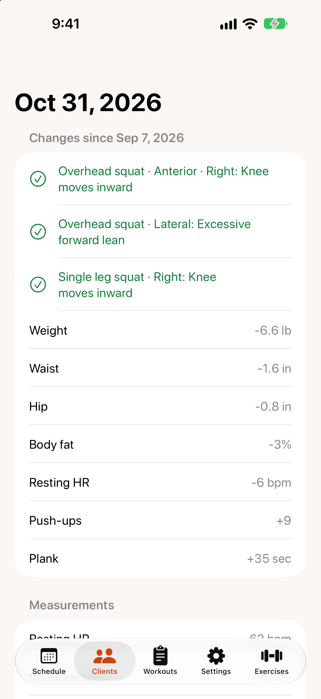

# Health screening, assessments and waivers

## Health screening

From a client's page, tap `New screening` (or `Latest screening` to review the most recent one).

1. Answer the screening questions — heart conditions, chest pain, dizziness, chronic conditions, medication, bone or joint problems, and whether the client should only exercise under supervision.
2. Add any conditions, surgeries, medications, family history and lifestyle details (sleep, stress, tobacco, alcohol, activity level).
3. Tap `Save`.

**Any YES answer means medical clearance is recommended before training.** The client's page and every session show a warning until you turn on `Clearance received` and record the date.

The screening is not a diagnosis, and TrainMe does not give medical advice.

## Assessments

{: width="300"}

From a client's page, tap `New assessment`.

1. Choose which sections to record: **Measurements**, **Overhead Squat** and **Single Leg Squat**.
2. **Measurements:** vitals (resting heart rate, blood pressure), body (height, weight, waist, hip, body fat) and fitness (push-ups, plank time).
3. **Overhead Squat:** for each view (anterior, lateral, posterior), tap the compensations you see. Use **R** and **L** to mark the right or left side.
4. **Single Leg Squat:** tap the compensations for each leg.
5. Add notes and tap `Save`.

Open an assessment to see **Changes since** the previous one: compensations that went away are ticked, and every measurement shows its change.

## Liability waiver

### Send a waiver

1. On the client's page, in **Waiver**, tap `Send waiver…`.
2. TrainMe prepares the waiver as a PDF with the client's name. Choose how to send it — Messages, Mail, AirDrop or anything else on the share sheet.
3. The client signs it outside the app and returns it to you.

The waiver is only marked as sent if you actually share it.

### Record the signed copy

When the client returns it, tap `Mark signed & returned…`, choose the date, and tap `Save`. Previous waivers are listed under **History**.

### Edit the waiver template

Go to `Settings` › `Liability waiver template`.

- Lines in ALL CAPS become headings.
- Start a line with `!!` to make it bold.
- Lines starting with `#` are hidden.

Tap `Save` to publish a new version; clients you've already sent a waiver to keep the version they received. `Reset to starter text` restores the original template.

> The starter waiver is a template, not legal advice. Have it reviewed by your attorney or insurer before using it.
