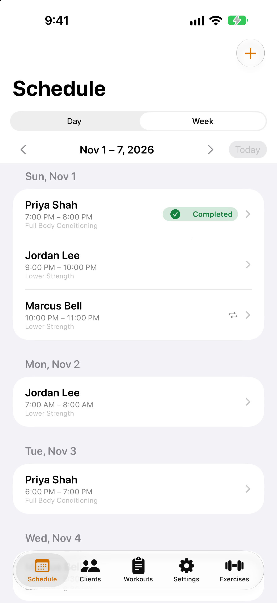

# TrainMe User Guide

TrainMe keeps your clients, workouts and training sessions on your iPhone, with a rest timer on your Apple Watch. This guide walks through every part of the app.

{: width="300"}

## TrainMe at a glance

TrainMe has five tabs along the bottom of the screen:

| Tab | What it's for |
|---|---|
| `Schedule` | Your sessions by day or week. Open a session to run it. |
| `Clients` | Everyone you train, their intake, assessments and progress. |
| `Workouts` | Reusable workout templates. |
| `Exercises` | Your exercise library. |
| `Settings` | Units, timers, the waiver template, backup, permissions and app info. |

## Contents

1. [Getting started](getting-started.md)
2. [Clients and intake](clients-and-intake.md)
3. [Health screening, assessments and waivers](health-assessments-waivers.md)
4. [Workouts and exercises](workouts-and-exercises.md)
5. [Scheduling sessions](scheduling.md)
6. [Running a session](running-a-session.md)
7. [Apple Watch](apple-watch.md)
8. [Progress reports](reports.md)
9. [Backup and restore](backup-and-restore.md)
10. [Settings](settings.md)
11. [Troubleshooting](troubleshooting.md)

Need more help? See [Support](../support.md).
