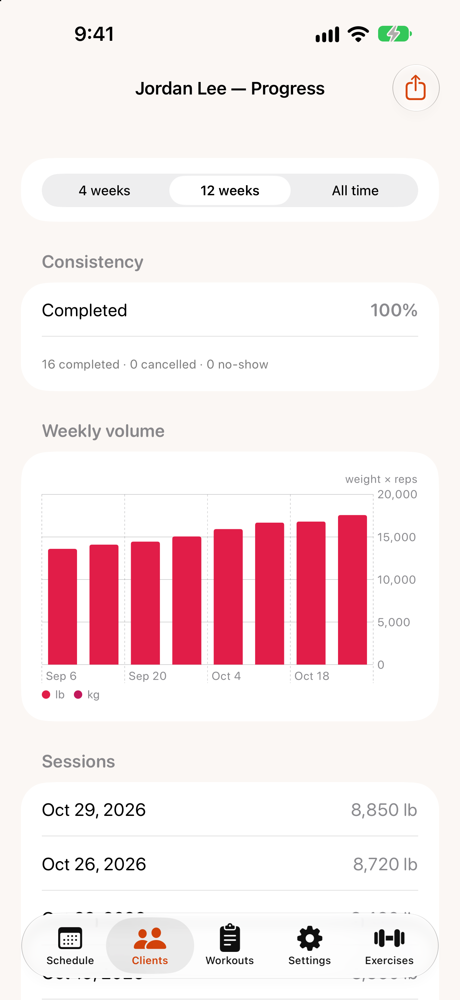

# Progress reports

{: width="300"}

Open a client and tap `View progress`.

## The report

Choose a `Window` at the top — 4 weeks, 12 weeks or all time.

- **Consistency:** the share of sessions completed, with counts of cancelled sessions and no-shows. TrainMe also flags past sessions still marked as scheduled, so you can tidy them up.
- **Weekly volume:** total weight × reps per week.
- **Sessions:** each completed session and its volume.
- **Top exercises:** the client's most-trained exercises. Tap one for its detail.

## Exercise detail

For a single exercise you'll see the client's **personal best**, top-set weight over time, **estimated 1RM (Epley)**, total reps, and the full history of sets.

## "Not enough data yet"

Charts need history: progress charts appear after you've recorded sets in completed sessions, and an exercise chart needs at least two completed sessions with that exercise.

## Share a report

Tap the share button (`Share report`) and choose `Share PDF` or `Share PNG` — send it to the client by Messages, Mail or anything on the share sheet.
