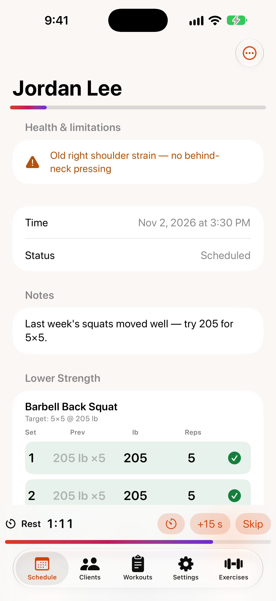

# Running a session

{: width="300"}

Open a session from the `Schedule` tab or from a client's page.

## Before you start

- **Health & limitations** shows the client's injuries and a warning if medical clearance is recommended.
- **Notes:** add or edit `Session notes`, then tap `Save notes`.
- The bar under the client's name shows how many planned sets you've logged.

## Log sets

Each exercise has a set table:

- **Prev** shows what the client did last time. Tap it to copy those numbers into the current set.
- Tap a number (weight, reps…) to change it with the stepper that appears below the table.
- Tap the ✓ at the end of the row to log the set.

Logged sets turn green. To remove one, tap its ✓ and confirm `Delete set`.

## Rest timer

Logging a set starts a rest countdown at the bottom of the screen (the length is set in [Settings](settings.md)). While it runs you can:

- tap **+15 s** to add time,
- tap `Skip` to end it,
- tap `Change` (the timer icon) to pick a different length.

When no timer is running, tap `Rest` to start one manually. TrainMe alerts you when time is up, even if your phone is locked. The timer also appears on your [Apple Watch](apple-watch.md).

## Timed sets

For timed exercises like a plank, tap **Start 45 s countdown** (the time matches the target). When it finishes, the duration is filled in for you — just log the set.

## Finish the session

At the bottom of the session:

- `Mark Completed` when you're done,
- `Cancelled` if it didn't happen,
- `No-show` if the client didn't turn up.

Completed sessions feed the client's [progress reports](reports.md).

## Text a reminder

Tap the message button (`Text reminder`) at the top to open a pre-written text to the client in Messages. You review it and tap Send yourself.
