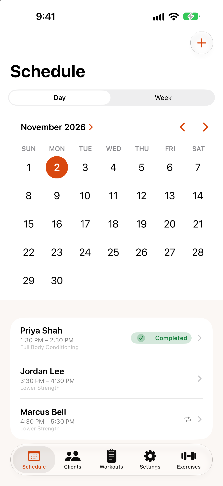
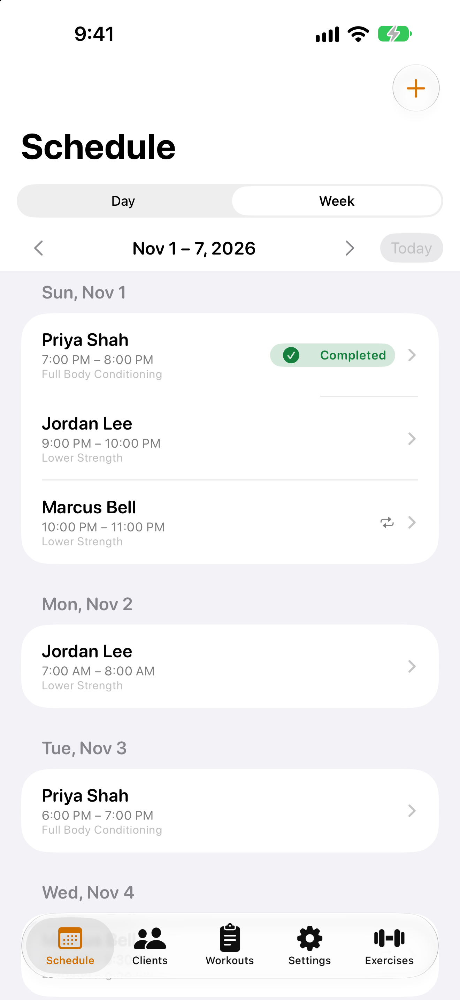

# Scheduling sessions

{: width="280"} {: width="280"}

## Day and week views

At the top of the `Schedule` tab, switch between **Day** and **Week**.

- **Day:** pick a date on the calendar to see that day's sessions.
- **Week:** see the whole week. Use `Previous week` and `Next week` (the arrows) to move, and `Today` to jump back.

Rackside remembers which view you used last. Each session shows the client, time, workouts and status; a ↻ icon means it repeats weekly.

## Schedule a session

1. Tap **+**.
2. Choose the client, the start time and the duration.
3. Under **Workouts**, tap the workout templates for this session.
4. To repeat it, turn on `Repeats weekly`, choose the days, and set how many weeks.
5. Add any notes.
6. Turn on `Add to iPhone calendar` if you want it in your calendar. (It goes to your default calendar, which can be Google Calendar if that's your default account.)
7. Tap `Save`.

Rackside reminds you 24 hours and 1 hour before each session, if notifications are allowed.

## Change, cancel or delete a session

Open the session and tap **⋯**: `Edit session` or `Delete session`. To cancel it but keep it in the history, tap `Cancelled` on the session screen.

For a repeating session, Rackside asks which sessions to change:

- `This session only`
- `This and following sessions`

Your calendar is updated to match.
