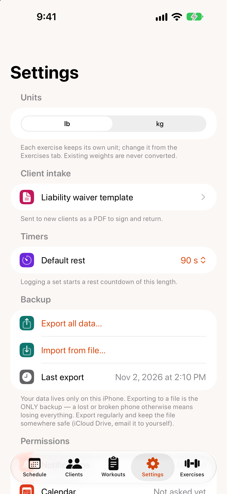

# Settings

{: width="300"}

- **Units:** the weight unit (lb or kg) for new exercises. Each exercise keeps its own unit, and existing weights are never converted.
- **Client intake:** `Liability waiver template` — edit the waiver you send to clients. See [waivers](health-assessments-waivers.md#liability-waiver).
- **Timers:** `Default rest` — how long the rest countdown runs after you log a set.
- **Backup:** `Export all data…`, `Import from file…` and when you last exported. See [Backup and restore](backup-and-restore.md).
- **Permissions:** whether Rackside can send notifications and use your calendar. If one is turned off, tap `Open Settings` to change it in the iOS Settings app.
- **About:** the Rackside version, and links to this guide, what's new, the privacy policy, support and the license.
