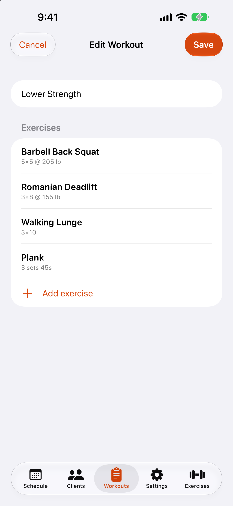
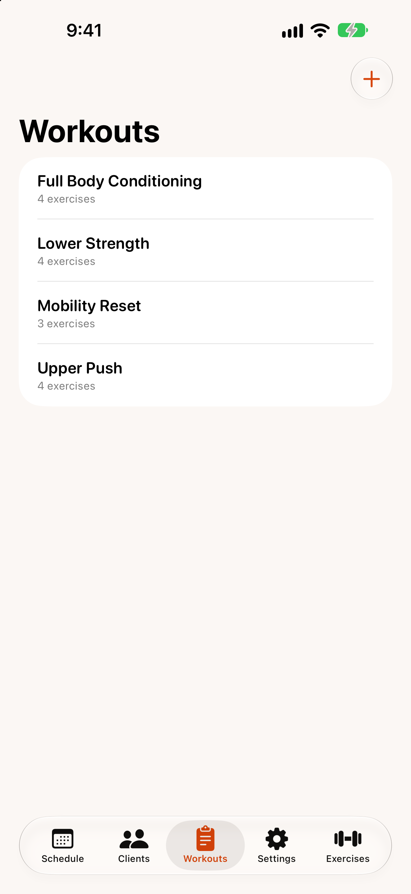
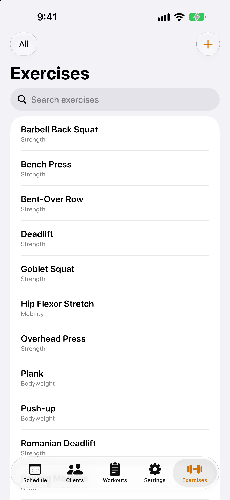

# Workouts and exercises

## Build a workout

{: width="300"}

1. Open the `Workouts` tab and tap **+**.
2. Enter a `Workout name`.
3. Tap `Add exercise`, search for an exercise and tap it.
4. Tap an exercise in the list to set its `Targets` — sets, reps, weight or duration.
5. Swipe left on an exercise to remove it.
6. Tap `Save`.

To change a workout later, tap it in the list. Swipe left on a workout to `Duplicate` it or `Delete` it. Deleting a template doesn't affect sessions already scheduled with it — each session keeps its own copy.

{: width="280"}

## Exercises

{: width="280"}

The `Exercises` tab lists every exercise. Use the search field to find one, or the `Category` menu (top left) to show only strength, cardio, bodyweight or mobility exercises. Exercises you created are marked **Custom**.

### Add or edit an exercise

1. Tap **+**, or tap an existing exercise.
2. Enter a name and choose a category.
3. Under `Tracked metrics`, turn on what you record for it: weight, reps, sets, duration and/or distance.
4. Choose its `Default unit` (lb or kg for weights; minutes or seconds; miles or kilometres).
5. Tap `Save`.

Each exercise keeps its own unit. Changing the unit never converts weights you've already recorded.
