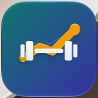

**TrainMe** is a client and session log for independent personal trainers. Keep your clients' goals, injuries and health screening in one place, build reusable workouts, schedule sessions, record every set as it happens with a rest timer on your iPhone or Apple Watch, and see each client's progress over time.

TrainMe works entirely on your iPhone. There is no account to create and no server: your data never leaves your iPhone unless you send it — to your calendar, a client's text messages, a shared report, or an export file you save.

- [User guide](guide/) — how to use every part of the app
- [What's new](changelog.md) — changes in each version
- [Privacy policy](privacy.md)
- [Support](support.md) — questions, problems and contact
